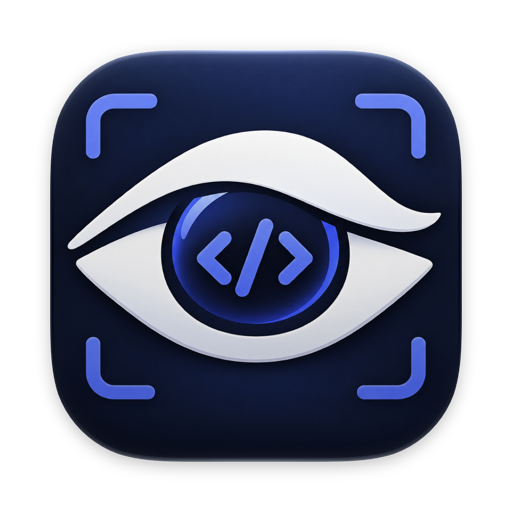
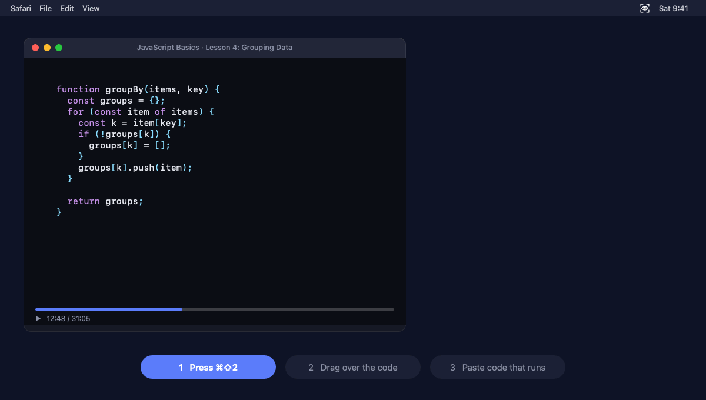
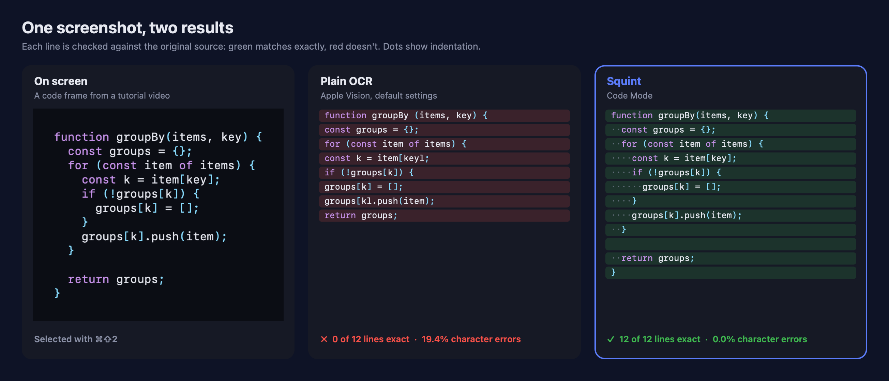

<div align="center">



# Squint

### Copy code from any screen, with its shape intact.

The on-device screen-OCR app for programmers. Squint keeps the indentation, blank lines and closing brackets that other OCR throws away, and drops the line numbers you never wanted.

[](https://github.com/Dhruv-Sharma29/Squint/actions/workflows/ci.yml)
[](docs/installation.md)
[](Package.swift)
[](#install)
[](#private-by-design)
[](LICENSE)

[**Website**](https://dhruv-sharma29.github.io/Squint/) · [**Install**](#install) · [**See the difference**](#see-the-difference) · [**Docs**](docs/usage.md) · [**Roadmap**](docs/roadmap.md)

<br>



</div>

<br>

<table>
<tr>
<td align="center" width="25%"><h3>5× fewer</h3>character errors than macOS's built-in text recognition, on benchmarks of real-world code</td>
<td align="center" width="25%"><h3>0.13 s</h3>from selection to clipboard</td>
<td align="center" width="25%"><h3>0 bytes</h3>leave your Mac: no account, no upload, no tracking</td>
<td align="center" width="25%"><h3>$0</h3>free and open source, with no trial and no upsell</td>
</tr>
</table>

<sub>Numbers from Squint's <a href="docs/evaluation.md">published benchmark</a>, including the results that aren't flattering.</sub>

## You've been here before

You pause a tutorial at 12:48. The code is right there on screen, and you can't select it.

So you reach for an OCR tool, and paste back a flat wall of text. The indentation is gone. Every line holding a lone `}` has vanished. The editor's line numbers are glued to the front of every line. `item[key]` became `item[keyl`, and `groupBy(items)` gained a space. For Python, lost indentation isn't cosmetic: it's a different program.

**Squint is screen OCR built for code.** Press **⌘⇧2**, drag over the code, paste. Indentation, blank lines and brackets come back the way they were on screen. No upload, no prompt, no waiting.

## See the difference

The same tutorial frame, read by plain OCR and by Squint. Each line is checked against the original source.



<sub>Real output, generated by <a href="scripts/ReadmeMedia/main.swift"><code>scripts/ReadmeMedia</code></a> from this exact frame. One example isn't a benchmark: across 102 test images in three benchmark sets, Squint averaged 2.1–3.0% character errors against 15.4–17.5% for macOS's built-in OCR. Most captures still need a small fix before they run. See <a href="docs/evaluation.md">how Squint is measured</a>.</sub>

## Why programmers will love it

<table>
<tr>
<td width="33%" valign="top">

### 📐 Indentation survives
Indentation, blank lines and column alignment come back the way they were on screen. Python stays Python.

</td>
<td width="33%" valign="top">

### 🧩 Missing brackets restored
Apple's OCR skips a line holding a lone `}` or `"""`. Squint sees the ink, works out what's still open, and puts it back.

</td>
<td width="33%" valign="top">

### 🔢 Line numbers stripped
Captured an editor with its gutter? Squint spots the column of line numbers and leaves it out.

</td>
</tr>
<tr>
<td valign="top">

### ✍️ No autocorrect on your code
Identifiers stay identifiers. `fib(n):` stays `fib(n):`, not `fib (n) :`, and `item[key]` doesn't turn into `item[keyl`.

</td>
<td valign="top">

### ⌨️ Your shortcut
**⌘⇧2** out of the box, or any combination you record in Settings. Squint tells you if another app already owns it.

</td>
<td valign="top">

### 🔍 Spotlight, Siri and Shortcuts
Type "Squint" in Spotlight to capture. In Shortcuts, every action hands back the text, ready for your next step. <sub>Needs a build signed with your Apple ID; see [Usage](docs/usage.md#spotlight-siri-and-shortcuts).</sub>

</td>
</tr>
<tr>
<td valign="top">

### 🔒 Private by design
Runs entirely on your Mac with Apple Vision. No account, no network, no telemetry. Screenshots are deleted as soon as they've been read.

</td>
<td valign="top">

### 📊 Measured, not promised
A public benchmark of 40 screenshots of real code, re-run before every accuracy change. `squint eval` lets you score your own screenshots.

</td>
<td valign="top">

### 💸 Free and open source
MIT-licensed, with no trial and no upsell. Every line is open to read, learn from and improve.

</td>
</tr>
<tr>
<td valign="top">

### ✅ Code that parses
When a capture doesn't parse, Squint tries fixes for the misreads that break it, and keeps one only if the whole snippet then parses.

</td>
<td valign="top">

### 📜 Longer than the screen
Scroll capture joins several captures by the lines they share, for a whole file from a long tutorial.

</td>
<td valign="top">

### 📋 Ready to paste anywhere
Copy as Markdown with the language tagged, tables as Markdown or spreadsheet columns, and an opt-in history of recent captures.

</td>
</tr>
</table>

**Also reads** tables (macOS 26 or later), emoji, QR codes and barcodes, screenshots on the clipboard, image files copied in Finder, and prose in up to 33 languages (including Hindi on macOS 27), with automatic language detection.

## Install

```sh
brew tap dhruv-sharma29/squint https://github.com/Dhruv-Sharma29/Squint
brew install dhruv-sharma29/squint/squint
brew services start squint     # start now and at every login
```

Homebrew builds Squint on your Mac in about 20 seconds, so there are no Gatekeeper warnings. It needs macOS 14 or later and Xcode or the Command Line Tools with Swift 6.1+. On first use, allow Squint under **System Settings › Privacy & Security › Screen Recording**, then reopen it. More options, including building from source, are in the [installation guide](docs/installation.md).

## Use it

| To | Do this |
|---|---|
| Copy code from the screen | **⌘⇧2** (or your shortcut), then drag over it |
| Capture from anywhere | Type **"Squint"** in Spotlight and pick Capture Code |
| Copy prose or other languages | Turn **Code Mode** off in the menu, or use **Capture Plain Text** |
| Read a screenshot already on the clipboard | **Read Clipboard Image** in the menu or Spotlight |
| Change the shortcut, open at login, pick a language | **Settings…** in the menu (⌘,) |
| Automate it | Shortcuts actions, `open "squint://capture"`, or `squint screenshot.png \| pbcopy` |

**Tip:** start the selection at the code's left margin, since indentation is measured from the leftmost line. More in the [usage guide](docs/usage.md).

## Private by design

- Recognition uses Apple's on-device Vision framework. Squint makes **no network requests**.
- Each screenshot exists only as a temporary file, and is **deleted as soon as it has been read**.
- No account, no analytics, no crash reporting. The only permission it asks for is Screen Recording.

## Under the hood

Vision returns boxes of text. Squint removes any line-number column (even when Vision reads only two of its numbers), places the rest on a line grid, turns left edges into indentation measured in character widths, and checks the pixels wherever Vision saw nothing. Where it finds ink, it restores the closing bracket or docstring quote that belongs there. It also fixes Vision's typical misreads of code, such as `{` read as `1` or `f`, `]` read as `l`, and template-literal backticks read as quotes. Every repair is deterministic, unit-tested, and explained in [How it works](docs/architecture.md).

## What's next

- **More captures that run as pasted:** about one in three test snippets parses as captured today; the target is nine in ten. Dropped `=` and `_` are the largest error left.
- **Real screenshots in the benchmark:** every number so far comes from rendered images.
- **One-command install** and signed, notarized builds.

The plan, with what's done and what's measured, is in the [roadmap](docs/roadmap.md).

## Documentation

| Guide | What's inside |
|---|---|
| [Installation](docs/installation.md) | Homebrew, building from source, permissions, updating, uninstalling, troubleshooting |
| [Usage](docs/usage.md) | Capturing, modes, Settings, Spotlight and Shortcuts, QR codes, clipboard, links, CLI, tips |
| [How it works](docs/architecture.md) | Pipeline, code-layout algorithm, design decisions, known limitations |
| [Evaluation](docs/evaluation.md) | Benchmark results, metrics, what the results mean, threats to validity |
| [Development](docs/development.md) | Building, testing, conventions, App Intents metadata, README media, releasing |
| [Roadmap](docs/roadmap.md) | Status, phased plan, success metrics |
| [Changelog](CHANGELOG.md) | Release history |

## Contributing

Issues and pull requests are welcome. Run `swift test` before you open a pull request; CI runs it too. If a change affects recognition, develop against the benchmark's dev set and include test-set results from before and after; see [Development](docs/development.md).

## Credits

Text recognition by Apple's [Vision](https://developer.apple.com/documentation/vision) framework. [TRex](https://github.com/amebalabs/TRex) by Ameba Labs (MIT) was a reference for the capture flow, the feature set and Homebrew distribution; Squint contains no TRex code.

## License

[MIT](LICENSE) © 2026 Dhruv Sharma
